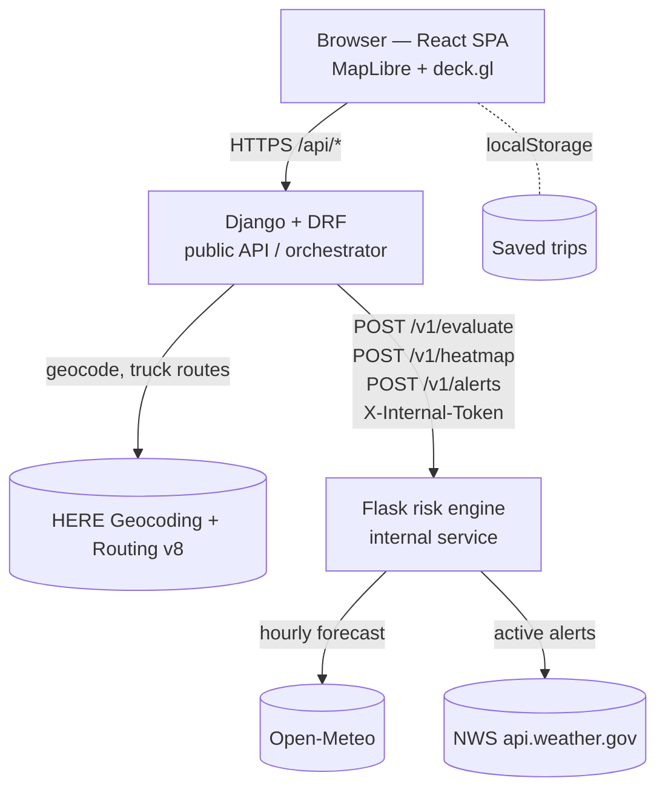
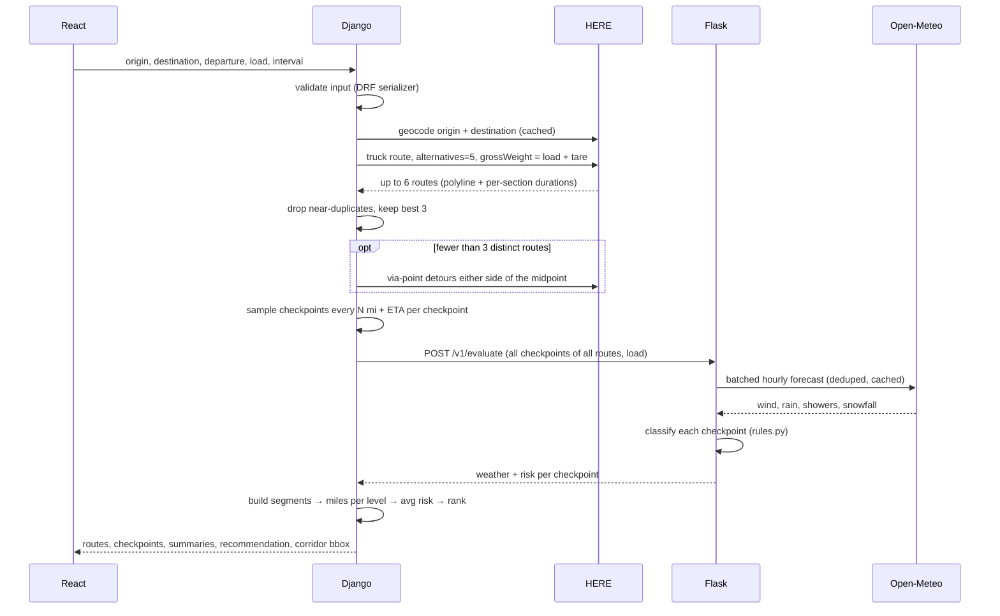

# Architecture — Weather-Aware Truck Routing System

**Chosen design:** Architecture B (Django orchestrator + Flask risk-engine microservice) with the heatmap optimization from Architecture C (corridor grid fetched once for all 48 hours; the slider only swaps preloaded frames).

> **Mandatory core** (see `projects specification.md` §0): CORE-1 three routes · CORE-2 time-aware checkpoint weather · CORE-3 risk/load rules · CORE-4 recommendation priorities · CORE-5 map visualization · CORE-6 0–48 h heatmap slider.
> The core logic lives in exactly one place each: rules in `risk_engine/rules.py`, ranking in `backend/scoring/rank.py`. Non-core components (alerts, saved trips, unit toggle) only **read** core results; they never alter them.

---

## 1. System overview



| Component | Responsibility | Does **not** do |
|---|---|---|
| **React SPA** | Inputs, map, markers, summaries, heatmap + slider, unit toggle, saved trips | Any risk logic or API keys |
| **Django** (public) | Validation, geocoding, routing, checkpoint sampling, ETA calculation, scoring & ranking, response assembly, proxying heatmap/alerts | Weather calls, threshold rules |
| **Flask risk engine** (internal) | Weather at ETA, risk + load rules, heatmap frames, alerts | Routing, ranking, anything user-facing |

**Why this split:** it follows the spec's own seams. Django owns the trip workflow; Flask owns one pure, heavily tested job: *weather + rules → risk*. The browser talks only to Django, so Flask stays private, CORS is simple, and keys live in one place per service.

## 2. Request flows

### 2.1 Analyze a trip — `POST /api/analyze`



### 2.2 Heatmap — `GET /api/heatmap` (Architecture C optimization)

1. After the analysis returns, React requests the heatmap for the **corridor bbox** (all routes, buffered 25 mi) starting at the departure hour.
2. Django forwards to Flask `POST /v1/heatmap`.
3. Flask builds a grid (≈ 12 × 12 to 16 × 16 cells), fetches **49 hourly frames (0–48 h)** in batched Open-Meteo calls, classifies each cell per hour, caches the result and returns compact arrays.
4. React keeps all frames in memory. The slider changes only the frame index, and deck.gl's `HeatmapLayer` re-renders on the GPU. **No network calls while scrubbing.**

### 2.3 Alerts — `POST /api/alerts` (non-core)

Django → Flask `POST /v1/alerts` → NWS active alerts for points along the routes (US only), deduplicated by alert ID, cached for 10 minutes. Alerts are shown for information only and never feed into risk levels or ranking.

### 2.4 Saved trips

Browser only. The trip inputs plus a short result summary are stored in `localStorage`; reopening a saved trip re-runs the analysis so weather is always fresh.

## 3. Core algorithms

| Step | Where | Method |
|---|---|---|
| Three routes (CORE-1) | `backend/geo/routes.py`, `routing/overlap.py` | Request up to 5 HERE alternatives; drop near-duplicates (> 90% of the shorter route within 100 m of the other, measured in metres); keep the 3 fastest distinct routes; if fewer than 3, try up to 6 via-point detours either side of the midpoint and record the attempts in `notes`. |
| Checkpoint sampling | `backend/routing/sampling.py` | Decode polyline → project to an equal-distance CRS (Shapely + pyproj) or walk with haversine → cut every N miles. Origin and destination are always checkpoints. |
| ETA per checkpoint | `backend/routing/track.py`, `sampling.py` | HERE duration per speed-limit span, spread over that span by distance (an approximation inside each span, exact at its ends) → cumulative elapsed time → `departure + elapsed` → round to nearest hour. |
| Risk classification | `risk_engine/rules.py` | Pure functions; half-open intervals; `max()` of factors + load override. |
| Route scoring | `backend/scoring/score.py` | Segments between checkpoints; segment level = worse endpoint; sum miles per level, with Severe and No Travel miles kept separate (D3); distance-weighted average. |
| Ranking (CORE-4) | `backend/scoring/rank.py` | Sort key `(no_travel_mi, severe_mi, high_mi, avg_risk, duration_s)` with D6 rounding (travel time unrounded): our safety key first (D4), then the spec's four keys in order. Rank 1 is recommended; routes with No Travel miles carry a warning. |

## 4. Repository layout

```
truck-routing/
├── frontend/                 # React + Vite + TypeScript
│   ├── src/
│   │   ├── api/              # typed API client + TanStack Query hooks
│   │   ├── components/       # TripForm, RouteCards, CheckpointPopup, Slider, AlertsPanel…
│   │   ├── map/              # MapView, route layers, markers, HeatmapLayer
│   │   ├── store/            # Zustand: selection, slider hour, units, saved trips
│   │   └── lib/              # units conversion, risk colours, formatting
│   └── tests/                # Vitest + Playwright
├── backend/                  # Django project
│   ├── config/               # settings, urls
│   ├── api/                  # DRF views + serializers
│   ├── geo/                  # HERE geocoding + routing clients
│   ├── routing/              # sampling, ETA
│   ├── scoring/              # segments, ranking
│   ├── clients/risk_engine.py
│   └── tests/
├── risk_engine/              # Flask service
│   ├── app.py                # routes: /health, /v1/evaluate, /v1/heatmap, /v1/alerts
│   ├── rules.py              # thresholds + load rules (pure)
│   ├── weather.py            # Open-Meteo client, unit normalisation, cache
│   ├── heatmap.py            # grid + frames
│   ├── alerts.py             # NWS client
│   └── tests/
├── shared/                   # truckrisk_schemas: Pydantic models used by both services
├── docs/                     # these documents
└── .github/workflows/ci.yml
```

## 5. Data & state

| Data | Lives in | Lifetime |
|---|---|---|
| Geocoding results | Django local-memory cache | 24 h |
| Routes | Not cached (depend on departure time) | Per request |
| Forecasts | Flask TTL cache, key = (lat, lon rounded to 0.1°, hour) | 30 min |
| Heatmap frames | Flask TTL cache, key = (bbox rounded, start hour, load) | 30 min |
| Alerts | Flask TTL cache | 10 min |
| Saved trips | Browser `localStorage` | Until the user deletes them |

No database is needed: the spec has no server-side persistence requirement. Redis and Postgres are deliberately left out to reduce deployment risk.

## 6. Deployment topology


| Service | Host | Environment variables |
|---|---|---|
| Frontend | Vercel | `VITE_API_BASE_URL`, `VITE_MAP_STYLE_URL` |
| Django | Render | `HERE_API_KEY`, `TRUCK_TARE_LB`, `RISK_ENGINE_URL`, `RISK_ENGINE_TOKEN`, `DJANGO_SECRET_KEY`, `ALLOWED_HOSTS`, `CORS_ALLOWED_ORIGINS` |
| Flask | Render | `RISK_ENGINE_TOKEN`, `NWS_USER_AGENT` |

Render's free services sleep when idle; the frontend calls `/api/health` on load to wake both services before the user submits.

## 7. Cross-cutting concerns

| Concern | Approach |
|---|---|
| **Units** | Every API value is imperial (mi, mph, in/hr, lb). The frontend converts for display only. |
| **Time** | All timestamps are ISO 8601 UTC on the wire; the UI shows local time with the zone. |
| **Errors** | One JSON error shape everywhere (see `API contracts.md`); upstream failures map to 502/504 with a readable message. |
| **Resilience** | httpx timeouts (connect 5 s, read 15 s), one retry with backoff on 5xx/timeouts, partial results never shown as complete. |
| **Security** | Keys in env vars only; Flask requires `X-Internal-Token`; CORS limited to the frontend origin; input validated server-side. |
| **Performance** | Weather requests deduped and batched; checkpoints fetched concurrently; heatmap fetched once per corridor. |
| **Accessibility** | Risk shown as text + colour + icon; colour-blind-safe palette; keyboard-operable slider and forms; ARIA labels. |

## 8. Key decisions (ADR summary)

| ADR | Decision | Reason |
|---|---|---|
| 001 | Architecture B + C heatmap technique | Clear service split; smooth slider without Celery |
| 002 | HERE Routing v8 in truck mode | Truck-aware, alternatives on long routes, takes gross weight |
| 003 | Open-Meteo for forecasts | Free, keyless, hourly, imperial units, multi-location requests |
| 004 | Flask stays internal behind Django | One public origin, simpler CORS, secrets isolated |
| 005 | No database or Redis | Not required by the spec; fewer moving parts to deploy |
| 006 | MapLibre + deck.gl | WebGL rendering for routes, markers and a 49-frame heatmap |
| 007 | Conservative segment attribution (worse endpoint) | Safety-first reading of "Severe miles" |
| 008 | Severe and No Travel miles kept separate; fewest No Travel miles ranked first, then the spec's four keys | The spec doesn't say how No Travel ranks; this stops an impassable route from winning without reordering the spec's keys |
| 009 | Router gets gross weight (load + configurable tare); rules use load as entered | The router needs total vehicle weight; the spec's load rules refer to the load |
